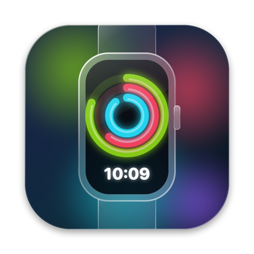
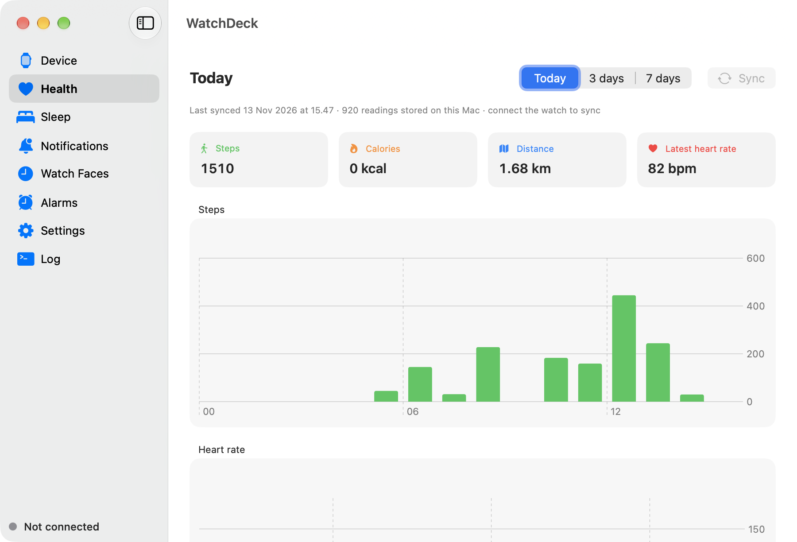
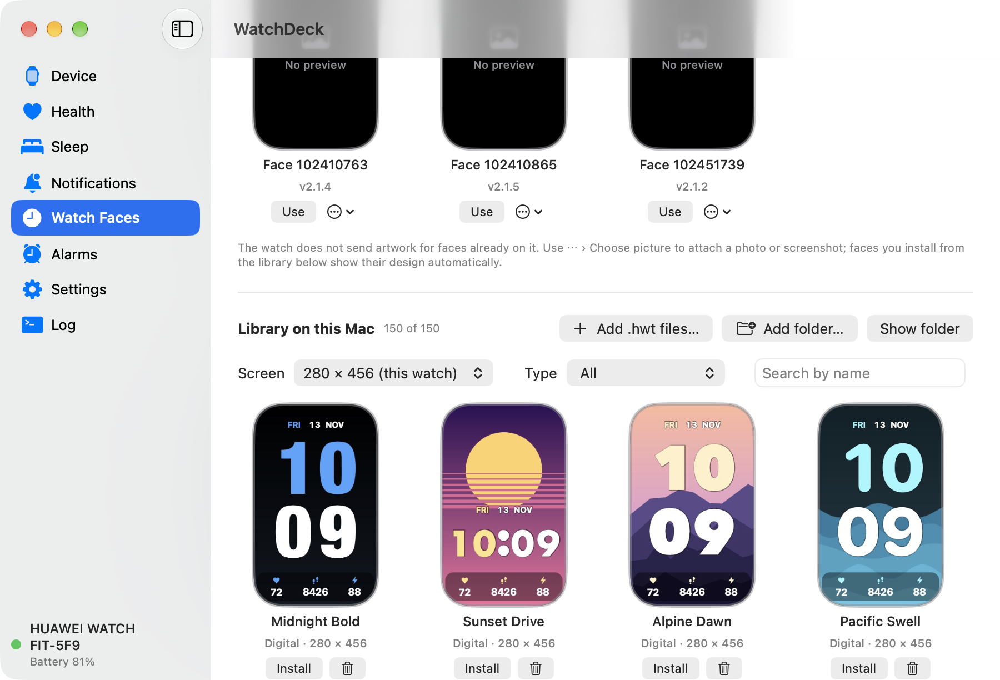
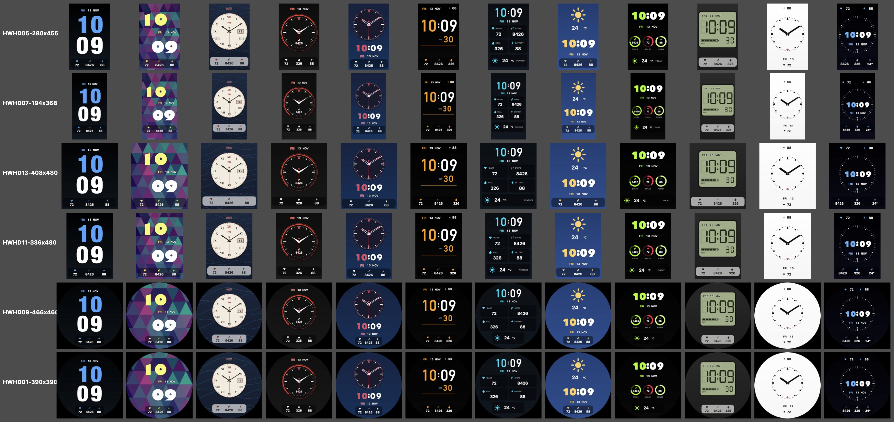

# WatchDeck ⌚️

A Mac app that controls Huawei and Honor watches and bands over Bluetooth, with no phone and no Huawei Health app.

Made by **[@lemonspitz](https://github.com/lemonspitz)** · version 1.0



## What it does

- **Device:** find and pair your watch, see the model, firmware and battery, and make the watch ring.
- **Health:** steps, calories, distance, heart rate and SpO₂ for today, 3 days or 7 days. Hover over a chart to read the exact value at any time.
- **Sleep:** each night's deep and light sleep on a timeline, with nightly totals.
- **Workouts:** every workout with its GPS route on a map, heart rate, speed or pace, splits, calories and climb. Hovering a chart shows where you were on the map at that moment. Export any workout as GPX for Strava, Komoot or Google Earth.
- **Watch faces:** list, switch, rename and delete the faces on the watch, and install `.hwt` faces from your Mac. WatchDeck can draw its own **150 designs** (digital, analog, sport, hybrid, dashboard, weather, activity rings, retro LCD, minimal and orbit) for your watch's exact screen size.
- **Notifications, alarms and settings:** send notifications to the watch, set alarms, and change wrist, raise-to-wake, time format, do-not-disturb and more.
- **GPS assist:** sends the Mac's position and exact time to the watch so its GPS locks faster.
- Everything the watch sends is saved on your Mac, so your history stays even after the watch forgets it.

## Screenshots





The same designs drawn for every screen size:



## Supported watches

WatchDeck knows **69 Huawei and Honor models**: the Watch Fit series, Watch GT series, Watch 3/4, Band 4 to 9, Honor Band, Honor Watch and MagicWatch, and others. It picks the right Bluetooth link and pairing method for each.

| Tested on real hardware | Status |
| --- | --- |
| HUAWEI Watch Fit (original) | ✅ pairing, health, sleep, workouts with GPS, faces, settings |
| Other models | Written from the protocol, not yet tried. Please open an issue with what works and what doesn't. |

**Before you start:**
- A watch can have only one companion. If yours is set up with Huawei Health on a phone, **reset it to factory settings** before pairing it with WatchDeck.
- Watch Fit 2 and newer models use classic Bluetooth: pair the watch once in **System Settings › Bluetooth**, then press Connect in WatchDeck.

## Install

**Requirements:** an Apple Silicon Mac (M1 or later), macOS 13 or later.

**One-line install (easiest):** paste this into Terminal and press Return:

```bash
curl -fsSL https://raw.githubusercontent.com/lemonspitz/WatchDeck/main/install.sh | bash
```

**Or download it:** get `WatchDeck.dmg` from the [latest release](https://github.com/lemonspitz/WatchDeck/releases/latest), open it and drag WatchDeck onto Applications. The app is not notarized, so the first time, right-click WatchDeck and choose **Open**, or run:

```bash
xattr -dr com.apple.quarantine /Applications/WatchDeck.app
```

## Build from source

```bash
./build.sh            # builds build/WatchDeck.app and build/facemaker
./release.sh          # also makes build/release/WatchDeck.dmg and .zip
build/WatchDeck.app/Contents/MacOS/WatchDeck --selftest
```

The face designer can also run on its own: `build/facemaker <output folder> [screen code or WxH] [design number]`.

## Privacy

WatchDeck talks only to your watch. Health data, sleep, workouts and routes stay in `~/Library/Application Support/WatchDeck` on your Mac. Location is used only for GPS assist and is sent only to the watch.

## Credits and licence

The Huawei Link protocol and pairing were learned from the [Gadgetbridge](https://codeberg.org/Freeyourgadget/Gadgetbridge) project, so WatchDeck is released under the **GNU AGPL-3.0** like Gadgetbridge. The `.hwt` face format was learned from [stia-hwt-packer](https://github.com/Apiratchai/stia-hwt-packer) (MIT).

Faces are drawn on your own Mac using its fonts. WatchDeck is not affiliated with Huawei or Honor.
